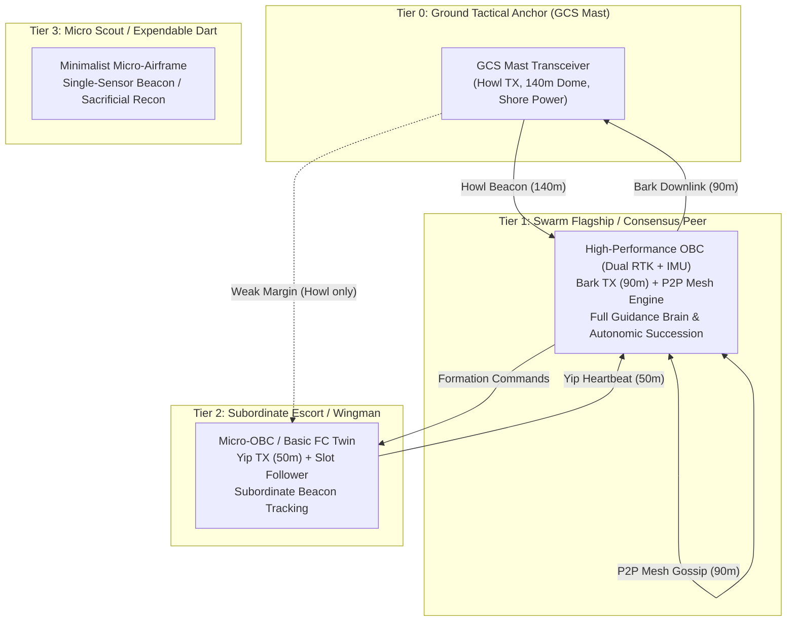

# AlitheiaHive Swarm Hardware Tiers & Comms Topology Specification

> **Document ID**: `SPEC-SWARM-TIERS-V1`  
> **Status**: Approved Architectural Landmark  
> **Airgaps Governed**: Operator Airgap (Bubble 1), Brain Airgap (Bubble 2), World Engine Ground Truth (Bubble 3)

---

## 1. Overview & Operational Intent

The Alitheia swarm architecture operates across a heterogeneous hierarchy of hardware tiers ($T_0$ through $T_3$). Each tier defines strict constraints on compute budget, radio link capabilities, sensor payload, and autonomic command authority.

Previous ambiguity regarding comms mode toggles (e.g., attempting to switch from a hardline physical tether to wireless P2P mesh mid-flight) stemmed from treating physical hardware configurations as soft UI toggles. This specification establishes the physical invariants governing each tier and topology.

---

## 2. Hardware Tier Classification ($T_0$ to $T_3$)

| Tier | Designation | Compute & OBC Architecture | Radio Transceiver & Link Budget | Sensor Suite & Navigation | Autonomic Authority & Succession |
| :--- | :--- | :--- | :--- | :--- | :--- |
| **$T_0$** | **Ground Anchor / GCS Mast** | Fixed base station compute; AC shore power / field generator. | High-power directional/omni mast (**Howl TX: 140m dome**). | Static RTK reference station; barometric base station. | **Operator Command Deck**. Never an airframe. Pushes mission intents. |
| **$T_1$** | **Swarm Flagship / Full Consensus Peer** | High-performance onboard computer (Linux SBC / quad-core CM4 / dual-core ESP32-S3). Full Python kinematics & boid solver. | Medium-power transceiver (**Bark TX: 90m range**). Multi-hop P2P mesh capable. | Dual RTK GNSS, 9-DOF IMU, downward rangefinder, optical flow. | **Full Swarm Commander**. Succession score: `(1 * 1000) - ID`. Eligible for dynamic 2IC / Leader promotion. |
| **$T_2$** | **Escort Wingman / Dumb Follower** | Lightweight micro-OBC (Cortex-M4/M7 MicroPython or dumb FC twin). Point-mass slot pursuit only. | Low-power micro-transceiver (**Yip TX: 50m range**). Subordinate uplink/downlink only. | Standard single-frequency GPS, basic 6-DOF IMU. | **Follower Only**. Cannot run decentralized gossip consensus. Steers strictly to leader beacon or local LKP. Succession score: `(2 * 1000) - ID`. |
| **$T_3$** | **Expendable Scout / Recon Dart** | Minimalist micro-controller. Fixed short-range battery. | Short-range chirp transceiver (< 25m). | Basic IMU, forward optical sensor. | **Zero Command Authority**. Sacrificial forward scout. Succession score: `0`. |

---

## 3. Comms Topologies & Physical Invariants

### 3.1 Mode 1: Tethered Relay (`TETHERED_RELAY`)
* **Physical Reality**: Flagship Drone #0 is anchored to the ground mast via a 40.0m physical high-tensile power/data umbilical.
* **Airgap Invariant**: **Mission-Start Configuration Only**. A drone cannot sprout a physical tether mid-air. Switching to or from Tethered Relay mid-flight is physically invalid and treated strictly as a God-Mode fault injection in World Engine (WE).
* **Severance Dynamics**: Umbilical strain ($d > 40\text{m}$) or follower collision ($d \le 1.0\text{m}$) triggers tensile breakaway, altitude-gated escape dive ($\Delta Z = -4.0\text{m}$), and dynamic promotion of the primary $T_1$ escort to wireless leader.

### 3.2 Mode 2: Wireless Star (`LEADER_FOLLOWER`)
* **Fleet Heterogeneity**: 
  - Primary Flagship (Drone #0) and 2IC (Drone #1) are **$T_1$** airframes.
  - Remaining fleet members (Drones #2..N) are **$T_2$** escorts.
* **Operational Protocol**:
  - GCS communicates directly with $T_1$ Flagship via Howl/Bark link.
  - Followers listen to $T_1$ Flagship Bark beacon (10 Hz) and track designated geometric slots.
  - Followers emit low-power Yip heartbeats back to the leader.
  - If Leader drops, 2IC ($T_1$) autonomic succession engages instantly.

### 3.3 Mode 3: P2P Gossip Mesh (`GOSSIP_CONSENSUS`)
* **Fleet Homogeneity**: **ALL active airframes must be $T_1$**.
* **Operational Protocol**:
  - No single leader. Every drone runs decentralized gossip routing, Hungarian slot assignment, and echo-ack quorum consensus.
  - Peer states broadcast at 10 Hz over Bark transceivers (90m range).
  - Swarm is resilient to any $N - 1$ casualties without operational pause.
* **Transition Constraint**: A heterogeneous fleet containing $T_2$ escorts **cannot** natively switch to true P2P mesh; $T_2$ airframes lack the compute and radio bandwidth to participate in decentralized consensus.

---

## 4. World Engine (WE) vs GCS Ground Truth Airgap

1. **Deployment State (Ground vs Air)**:
   - **WE Governs Ground Truth**: The World Engine simulator decides if drones initialize cold on ground pads (`GROUND_IDLE`, $Z = 0.05\text{m}$) or mid-air ($Z = 20.0\text{m}$).
   - **GCS Renders Only**: GCS never possesses a button to change where drones spawn. It reads telemetry: if `flight_state == "GROUND_IDLE"`, GCS displays pad indicators and enables operator `SCRAMBLE SWARM`.
2. **Landing Pad Clearance & Operator Incompetence**:
   - GCS has an operator action `[CLEAR PAD RECORD]`, which only clears the operator's display log.
   - If the operator clears a pad without the ground crew physically retrieving the drone in WE:
     - The physical drone remains sitting at $Z = 0.05\text{m}$ on Pad $K$.
     - When a subsequent drone is ordered to land on Pad $K$, the descending drone collides with the un-retrieved airframe at $Z \le 1.5\text{m}$ (Zone 4 prop clash).
     - Result: **Both airframes destroyed due to operator incompetence**.
   - Physical pad clearing requires manual retrieval in WE (God-Mode / Ground Crew).
