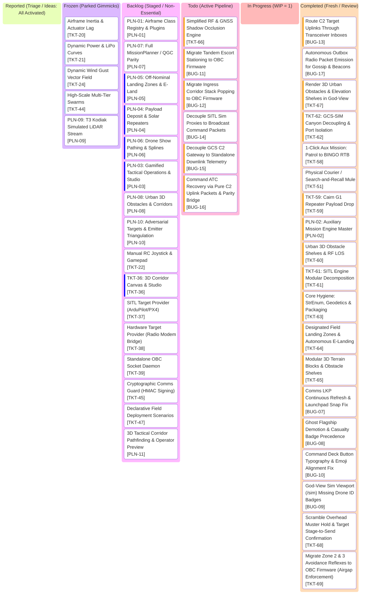

# AlitheiaHive_v3-Uprising: Project Kanban Board

> **Tactical GCS Workflow & Task Lifecycle** | **Palette: Dark Navy (#061019) & Neon Cyan (#00F0FF)**  
> *50/50 Architecture: Pure Python Kinematics & GPU-Native Three.js Rendering across 4 Airgaps*

---

## 1. Visual Task Lifecycle Board

---

## 2. Active Engineering Task Index

> *Detailed blueprints, acceptance criteria, and root cause notes live in isolated modular documents:*
> * Active / Completed specs: [`tasks/`](tasks/)
> * Backlog candidates: [`tasks/backlog/`](tasks/backlog/)
> * Settled milestone archives: [`tasks/archived/`](tasks/archived/)

| Ticket ID | Grade | Title | Operational Inspiration | Spec Document |
| :--- | :--- | :--- | :--- | :--- |
| **`TKT-62`** | `🛠️ Refactor` | GCS-SIM Canyon Decoupling & Port Isolation | GCS operates strictly over UDP 9000/9001 without in-memory sim handles | [TKT-62.md](tasks/TKT-62.md) |
| **`TKT-61`** | `🛠️ Refactor` | SITL Engine Modular Decomposition (Extract RF & ATC) | Decompose 4,327-line monolith into rf_channel.py & atc_recovery.py | [TKT-61.md](tasks/TKT-61.md) |
| **`TKT-59`** | `🚀 Feature` | 1-Click Aux Mission: Cairn G1 Solar Repeater Payload Drop | Precision payload release at Z=3m, ground solar repeater joins gossip mesh | [TKT-59.md](tasks/TKT-59.md) |
| **`TKT-51`** | `🚀 Feature` | Physical Courier / Search-and-Recall Mule to LKP | Targeted LKP dwell, P2P rescue handshake, and reverse tandem escort | [TKT-51.md](tasks/TKT-51.md) |
| **`TKT-58`** | `🚀 Feature` | 1-Click Aux Mission: Patrol to BINGO RTB | Autonomous patrol looping until BINGO battery triggers automated 2-stage RTB | [TKT-58.md](tasks/TKT-58.md) |
| **`PLN-02`** | `🏗️ Epic` | Auxiliary Mission Concepts & Waypoint Engine (Tactical Sub-Routines) | Phased mission workflows: Waypoint queues & discrete sub-routines | [PLN-02.md](tasks/PLN-02.md) |
| **`PLN-01`** | `🏗️ Epic` | Airframe Class Registry & Hardware Plugins | Formal classes (Den, Totem, Cairn, etc.) and capabilities | [PLN-01.md](tasks/backlog/PLN-01.md) |
| **`PLN-07`** | `🏗️ Epic` | Full MissionPlanner & QGC Compatibility | MAVLink mission item upload/download, param sync | [PLN-07.md](tasks/backlog/PLN-07.md) |
| **`PLN-05`** | `🏗️ Epic` | Off-Nominal Landing Zones & Field E-Land | Dynamic field landing zones and emergency touches | [PLN-05.md](tasks/backlog/PLN-05.md) |
| **`PLN-04`** | `🏗️ Epic` | Payload Deposit & Solar Repeaters | Precision drop zones, Cairn G1 solar repeaters | [PLN-04.md](tasks/backlog/PLN-04.md) |
| **`PLN-06`** | `🏗️ Epic` | Choreographic Formations & Individual Pathing | Drone show spline curves, 3D waypoint spline grids | [PLN-06.md](tasks/backlog/PLN-06.md) |
| **`PLN-03`** | `🏗️ Epic` | Gamified Tactical Operations & Scenario Studio | Declarative scenarios, procedural generator, RTS squads, and objective debrief | [PLN-03.md](tasks/backlog/PLN-03.md) |
| **`PLN-08`** | `🏗️ Epic` | Urban 3D Obstacles & Safe Flight Corridors | 3D AABB altitude shelves, safe corridor tubes, and LOS RF shadows | [PLN-08.md](tasks/backlog/PLN-08.md) |
| **`PLN-09`** | `🏗️ Epic` | T3 Kodiak Simulated LiDAR Stream | 16-32 ray range returns and pointcloud HUD | [PLN-09.md](tasks/backlog/PLN-09.md) |
| **`PLN-10`** | `🏗️ Epic` | Adversarial Targets & Emitter Triangulation | Mobile RF jammers, AoA triangulation, maze exploration | [PLN-10.md](tasks/backlog/PLN-10.md) |
| **`TKT-22`** | `🚀 Feature` | Manual RC Joystick & Gamepad Override | Operators lacking pilot stick controls | [TKT-22.md](tasks/backlog/TKT-22.md) |
| **`TKT-36`** | `🚀 Feature` | Interactive 3D Corridor Canvas & Scenario Studio | Plan mode designer canvas, 3D corridor drawing, and scenario export | [TKT-36.md](tasks/backlog/TKT-36.md) |
| **`TKT-37`** | `🛠️ Improvement` | SITL Target Provider (ArduPilot / PX4) | Need external autopilot verification without changing GCS | [TKT-37.md](tasks/backlog/TKT-37.md) |
| **`TKT-38`** | `🛠️ Improvement` | Hardware Target Provider (Radio Modem Bridge) | Preparing core for field testing with real airframes | [TKT-38.md](tasks/backlog/TKT-38.md) |
| **`TKT-39`** | `🛠️ Improvement` | Standalone Drone OBC Network Daemon | OBC firmware tied to top-layer process | [TKT-39.md](tasks/backlog/TKT-39.md) |
| **`TKT-45`** | `🚀 Feature` | Cryptographic Comms Guard (HMAC Signing) | Unauthenticated packets allowing rogue SDR injection | [TKT-45.md](tasks/backlog/TKT-45.md) |
| **`TKT-47`** | `🛠️ Improvement` | Declarative Field Deployment Scenarios | Ground components clumped at identical (0,0,0) | [TKT-47.md](tasks/backlog/TKT-47.md) |
| **`TKT-51`** | `🚀 Feature` | Physical Courier / Search-and-Recall Mule | Fragile daisy chains dropping on single node loss | [TKT-51.md](tasks/TKT-51.md) |
| **`TKT-20`** | `🎭 Gimmick` | Airframe Inertia & Actuator Dynamics | Point-mass kinematics yielding instant vector jumps | [TKT-20.md](tasks/backlog/TKT-20.md) |
| **`TKT-21`** | `🎭 Gimmick` | Dynamic Power Envelope (LiPo Curves) | Static 100% telemetry display without power curves | [TKT-21.md](tasks/backlog/TKT-21.md) |
| **`TKT-24`** | `🎭 Gimmick` | Dynamic Wind Gust Vector Field | Airframe operating in ideal dead-calm air | [TKT-24.md](tasks/backlog/TKT-24.md) |
| **`TKT-44`** | `🎭 Gimmick` | High-Scale Multi-Tier Swarm Formations | Formations stretching beyond radio range at large counts | [TKT-44.md](tasks/backlog/TKT-44.md) |
| **`TKT-60`** | `🚀 Feature` | Urban 3D Obstacle Shelves & RF LOS | 3D AABB altitude shelves, structural clash, and ray-cast RF LOS shadowing | [TKT-60.md](tasks/TKT-60.md) |
| **`TKT-63`** | `🛠️ Refactor` | Core Hygiene: StrEnum, Geodetics & Packaging | StrEnum flight states, PyMAVLink geodetics, and UV packaging | [TKT-63.md](tasks/TKT-63.md) |
| **`TKT-64`** | `🚀 Feature` | Designated Field Landing Zones (FLZ) & Autonomous E-Landing | PLN-05 Off-Nominal Landing Zones & Field E-Land (50/50 Architecture across 4 Airgaps) | [TKT-64.md](tasks/TKT-64.md) |
| **`TKT-65`** | `TKT` | Modular 3D Terrain Blocks & Obstacle Shelves | PLN-08 Cyberpunk Obby Steppes, Altitude Shelves & Dynamic Surface Floor Clamping | [TKT-65.md](tasks/TKT-65.md) |
| **`TKT-66`** | `TKT` | Simplified RF & GNSS Shadow Occlusion Engine | PLN-08 Ray-Cast RF Shadows, Virtual 4-Satellite GNSS Constellation & Dead-Reckoning Failsafe | [TKT-66.md](tasks/TKT-66.md) |
| **`BUG-07`** | `BUG` | Comms LKP Continuous Refresh & Launchpad Snap Fix | Drone snapping to launchpad on comms drop because LKP was never updated during flight | [BUG-07.md](tasks/BUG-07.md) |
| **`BUG-08`** | `BUG` | Ghost Flagship Demotion & Casualty Badge Precedence | Dead/demoted leaders retained flagship status in telemetry and masked crash/lost-link badges | [BUG-08.md](tasks/BUG-08.md) |
| **`BUG-09`** | `BUG` | God-View Sim Viewport (/sim) Missing Drone ID Badges | Sim viewport /sim renders collision spheres and rotors but lacks drone ID badges | [BUG-09.md](tasks/BUG-09.md) |
| **`BUG-10`** | `BUG` | Command Deck Button Typography & Emoji Alignment Fix | Emoji characters in GCS command deck buttons cause vertical misalignment and line-height glitches | [BUG-10.md](tasks/BUG-10.md) |
| **`PLN-11`** | `PLN` | 3D Tactical Corridor Pathfinding & Operator Preview | Operator single-target 3D auto-pathfinding with corridor preview and confirmation before execution | [PLN-11.md](tasks/backlog/PLN-11.md) |
| **`TKT-67`** | `TKT` | Render 3D Urban Obstacles & Elevation Shelves in God-View | God-View /sim missing 3D obstacle meshes causing drones to clash into invisible buildings | [TKT-67.md](tasks/TKT-67.md) |
| **`TKT-68`** | `TKT` | Scramble Overhead Muster Hold & Target Stage-to-Send Confirmation | Active task specification | [TKT-68.md](tasks/TKT-68.md) |
| **`TKT-69`** | `TKT` | Migrate Zone 2 & 3 Avoidance Reflexes to OBC Firmware (Airgap Enforcement) | Active task specification | [TKT-69.md](tasks/TKT-69.md) |
| **`BUG-11`** | `BUG` | Migrate Tandem Escort Stationing to OBC Firmware | Strict Brain Airgap enforcement for Search-and-Recall courier tandem missions (Red 2) | [BUG-11.md](tasks/BUG-11.md) |
| **`BUG-12`** | `BUG` | Migrate Ingress Corridor Stack Popping to OBC Firmware | Autonomic onboard reverse backtrack corridor execution (Red 3) | [BUG-12.md](tasks/BUG-12.md) |
| **`BUG-13`** | `BUG` | Route C2 Target Uplinks Through Transceiver Inboxes | GCS and tether links deliver packets to inbox, never mutating drone RAM (Red 4) | [BUG-13.md](tasks/BUG-13.md) |
| **`BUG-14`** | `BUG` | Decouple SITL Sim Proxies to Broadcast Command Packets | Replace in-memory brain proxy iteration with RF broadcast command packets (Red 5) | [BUG-14.md](tasks/BUG-14.md) |
| **`BUG-15`** | `BUG` | Decouple GCS C2 Gateway to Standalone Downlink Telemetry | Complete Canyon Airgap decoupling: C2 Gateway operates standalone with sim=None (Red 6) | [BUG-15.md](tasks/BUG-15.md) |
| **`BUG-16`** | `BUG` | Command ATC Recovery via Pure C2 Uplink Packets & Parity Bridge | Decouple ATC recovery from God-mode actuator manipulation; complete Canyon UDP parity (Red 7 & Yellow 4) | [BUG-16.md](tasks/BUG-16.md) |
| **`BUG-17`** | `BUG` | Autonomous Outbox Radio Packet Emission for Gossip & Beacons | Forbid SITL from forging radio packets; OBC firmware autonomously emits beacons and gossip echoes (Red 8) | [BUG-17.md](tasks/BUG-17.md) |

---

## 3. Strategic Planning Epics (PLN Roadmap)

> High-level architectural pillars grouping candidate capabilities into coherent systems:

| Epic ID | Title | Scope & Operational Vision | Grouped Tickets / Prereqs |
| :--- | :--- | :--- | :--- |
| **PLN-01** | **Airframe Class Registry & Hardware Plugins** | Register formal classes (`Den`, `Totem`, `Cairn`, `Mastiff`, `Threadfin`, `Alpha`, `Beta`, `Pup`, `Kodiak`, `Kourier`, `Bloodhound`) with hardware plugins and capabilities. | `[TKT-48]`, `[TKT-49]` |
| **PLN-02** | **Auxiliary Mission Engine (Tactical Sub-Routines)** | Discrete waypoint queues first, then composable tactical sub-routines at the click of a button (`SEARCH_AND_RECALL`, `TOUCH_AND_GO_PROBE`, `PATROL_TO_BINGO`, `PAYLOAD_DEPOSIT`). | `[PLN-02]`, `[TKT-56]`, `[TKT-57]`, `[TKT-58]` |
| **PLN-03** | **Gamified Tactical Operations & Scenario Studio** | Declarative scenarios (`scenarios/*.json`), procedural generator, RTS squads, and GCS objective tracker. | Post-PLN-02 |
| **PLN-04** | **Payload Deposit & Solar Repeaters** | Precision payload drop zones, Cairn G1 solar repeater release, magnetic release hook mechanics. | `[PLN-04]` |
| **PLN-05** | **Off-Nominal Landing Zones & Field E-Land** | Dynamic field landing zones, free-landing clearance, emergency touchdowns anywhere safe besides Base pads. | `[TKT-47]` |
| **PLN-06** | **Choreographic Formations & Individual Pathing** | Drone show / custom formation curves, 3D waypoint spline grids, individual vehicle trajectory scripting. | `[TKT-36]` |
| **PLN-07** | **Full MissionPlanner & QGC Compatibility** | Bidirectional MAVLink mission item upload/download, parameter sync, standard GCS parity. | `[TKT-46]`, `[TKT-45]`, `[TKT-37]` |
| **PLN-08** | **Urban 3D Obstacles, Altitude Shelves & Safe Corridors** | 3D AABB altitude shelves ($Z_{\min}, Z_{\max}$), pre-cleared corridor pipes, and LOS RF shadows in urban channels. | `[PLN-08]`, `[TKT-54]` |
| **PLN-09** | **T3 Kodiak Simulated LiDAR Stream & Point-Cloud HUD** | 16–32 ray synthetic range returns on T3 Kodiak, Polar range-bearing UDP downlink, Three.js neon point-cloud HUD overlay. | `[PLN-09]`, `[PLN-01]` |
| **PLN-10** | **Adversarial Targets, Emitter Triangulation & Maze Exploration** | Mobile adversarial RF jammer targets, K1-EW 3-antenna AoA triangulation, autonomous maze corridor frontier exploration. | `[PLN-10]`, `[PLN-08]` |

---

## 4. Strict Kanban Governance Rules

1. **WIP = 1**: At most one active ticket in `In Progress` at any time.
2. **1-Card-1-Doc Scope**: All acceptance criteria, test commands, and architectural notes live in `roadmap/tasks/`. `roadmap/kanban.md` remains a lightweight index HUD.
3. **Verification Gate**: A code ticket moves to `Completed` only when its targeted test module passes. Non-code changes require zero tests.
4. **User Sign-Off**: Cards in `Completed` remain for user testing and review until explicitly approved for archival into `roadmap/tasks/archived/`.
