# AlitheiaHive_v3-Uprising: Project Kanban Board

> **Tactical GCS Workflow & Task Lifecycle** | **Palette: Dark Navy (#061019) & Neon Cyan (#00F0FF)**  
> *50/50 Architecture: Pure Python Kinematics & GPU-Native Three.js Rendering across 4 Airgaps*

---

## 1. Visual Task Lifecycle Board

```mermaid
%%{init: {
  'theme': 'base',
  'themeVariables': {
    'primaryColor': '#0d2235',
    'primaryTextColor': '#d4f4ff',
    'primaryBorderColor': '#00f0ff',
    'lineColor': '#00f0ff',
    'background': '#061019',
    'mainBkg': '#0a1926',
    'secondaryColor': '#081420',
    'secondaryTextColor': '#5a7e96',
    'secondaryBorderColor': '#134e6f',
    'tertiaryColor': '#0e263d',
    'tertiaryTextColor': '#00ffaa',
    'tertiaryBorderColor': '#00ffaa',
    'clusterBkg': '#081420',
    'clusterBorder': '#134e6f',
    'fontFamily': "'JetBrains Mono', 'Courier New', monospace"
  }
}}%%
kanban
  reported["Reported (Triage / Ideas: All Activated)"]
  frozen["Frozen (Parked Gimmicks)"]
    tkt20["Airframe Inertia & Actuator Lag"]@{ ticket: '[TKT-20]', priority: 'Very Low' }
    tkt21["Dynamic Power & LiPo Curves"]@{ ticket: '[TKT-21]', priority: 'Very Low' }
    tkt24["Dynamic Wind Gust Vector Field"]@{ ticket: '[TKT-24]', priority: 'Very Low' }
    tkt44["High-Scale Multi-Tier Swarms"]@{ ticket: '[TKT-44]', priority: 'Very Low' }
  backlog["Backlog (Staged / Non-Essential)"]
    pln01["PLN-01: Airframe Class Registry & Plugins"]@{ ticket: '[PLN-01]', priority: 'Medium' }
    pln07["PLN-07: Full MissionPlanner / QGC Parity"]@{ ticket: '[PLN-07]', priority: 'Medium' }
    pln05["PLN-05: Off-Nominal Landing Zones & E-Land"]@{ ticket: '[PLN-05]', priority: 'Low' }
    pln04["PLN-04: Payload Deposit & Solar Repeaters"]@{ ticket: '[PLN-04]', priority: 'Low' }
    pln06["PLN-06: Drone Show Pathing & Splines"]@{ ticket: '[PLN-06]', priority: 'Low' }
    pln03["PLN-03: Gamified Tactical Operations & Studio"]@{ ticket: '[PLN-03]', priority: 'Low' }
    pln08["PLN-08: Urban 3D Obstacles & Corridors"]@{ ticket: '[PLN-08]', priority: 'Medium' }
    pln09["PLN-09: T3 Kodiak Simulated LiDAR Stream"]@{ ticket: '[PLN-09]', priority: 'Medium' }
    pln10["PLN-10: Adversarial Targets & Emitter Triangulation"]@{ ticket: '[PLN-10]', priority: 'Medium' }
    tkt22["Manual RC Joystick & Gamepad"]@{ ticket: '[TKT-22]', priority: 'Medium' }
    tkt36["TKT-36: 3D Corridor Canvas & Studio"]@{ ticket: '[TKT-36]', priority: 'Low' }
    tkt37["SITL Target Provider (ArduPilot/PX4)"]@{ ticket: '[TKT-37]', priority: 'Medium' }
    tkt38["Hardware Target Provider (Radio Modem Bridge)"]@{ ticket: '[TKT-38]', priority: 'Medium' }
    tkt39["Standalone OBC Socket Daemon"]@{ ticket: '[TKT-39]', priority: 'Medium' }
    tkt45["Cryptographic Comms Guard (HMAC Signing)"]@{ ticket: '[TKT-45]', priority: 'Medium' }
    tkt47["Declarative Field Deployment Scenarios"]@{ ticket: '[TKT-47]', priority: 'Medium' }
  todo["Todo (Active Pipeline)"]
    pln02["PLN-02: Auxiliary Mission Engine Master"]@{ ticket: '[PLN-02]', priority: 'High' }
  in_progress["In Progress (WIP = 1)"]
  completed["Completed (Fresh / Review)"]
    bug06["OBC Failsafe Consolidation: t-GCSH, Relays & Corridor ERTB"]@{ ticket: '[BUG-06]', priority: 'Very High' }
    bug05["Downlink Telemetry Leak Beyond Bork Range"]@{ ticket: '[BUG-05]', priority: 'Medium' }
    bug04["Wireless Star Coordinate Collapse at Range"]@{ ticket: '[BUG-04]', priority: 'High' }
    bug03["P2P Mesh Split-Brain Target Oscillation"]@{ ticket: '[BUG-03]', priority: 'Very High' }
    bug02["Async RF Range Calculation / C2 Uplink Disconnect"]@{ ticket: '[BUG-02]', priority: 'Very High' }
    bug01["Fleet Telemetry Window Empty"]@{ ticket: '[BUG-01]', priority: 'High' }
    tlk01["Induced Coma OBC Airgap Resuscitation"]@{ ticket: '[TLK-01]', priority: 'Very High' }
    tkt57["Airframe Tier Registry & Authorization Gate"]@{ ticket: '[TKT-57]', priority: 'Medium' }
    tkt56["4D Waypoint Queue & Loiter Progress Engine"]@{ ticket: '[TKT-56]', priority: 'High' }
    tkt55["Tactical Formation Orientations & Perimeter Headings"]@{ ticket: '[TKT-55]', priority: 'High' }
    tkt54["Heartbeat Watchdog & Breadcrumb Backtrack"]@{ ticket: '[TKT-54]', priority: 'Very High' }
    fix10["Strict Network Decoupling & Landing Huddle Fix"]@{ ticket: '[FIX-10]', priority: 'High' }
    fix09["Strict WE-GCS Airgap & Comms Integrity"]@{ ticket: '[FIX-09]', priority: 'High' }
    tkt53["Flight Formation Test Suite & Playback"]@{ ticket: '[TKT-53]', priority: 'High' }
    tkt43["Dynamic Hungarian Formation Inversion"]@{ ticket: '[TKT-43]', priority: 'High' }
    tkt52["Tactical GNSS Denial & Dead-Reckoning"]@{ ticket: '[TKT-52]', priority: 'High' }
    tkt42["Batched ATC Pad Recovery"]@{ ticket: '[TKT-42]', priority: 'High' }
    tkt41["Cold-Start Pad Scramble"]@{ ticket: '[TKT-41]', priority: 'High' }
    tkt48["Airframe Hardware Identity Registry"]@{ ticket: '[TKT-48]', priority: 'High' }
    tkt50["Dynamic In-Flight Swarm Enrollment"]@{ ticket: '[TKT-50]', priority: 'Medium' }
    tkt49["Asymmetric RF Link Budget (Yip-Back)"]@{ ticket: '[TKT-49]', priority: 'High' }
    fix07["MAVLink Multi-Vehicle Telemetry"]@{ ticket: '[FIX-07]', priority: 'Very High' }
    fix08["Coordinated ATC Landing Station-Keeping"]@{ ticket: '[FIX-08]', priority: 'High' }
    fix06["MAVLink Multi-Vehicle Responders"]@{ ticket: '[FIX-06]', priority: 'Very High' }
    tkt23["Natural Reynolds 3D Flocking"]@{ ticket: '[TKT-23]', priority: 'High' }
    fix05["Comms Horizon Telemetry Gate"]@{ ticket: '[FIX-05]', priority: 'Very High' }
    tkt58["1-Click Aux Mission: Patrol to BINGO RTB"]@{ ticket: '[TKT-58]', priority: 'Medium' }
    tkt51["Physical Courier / Search-and-Recall Mule"]@{ ticket: '[TKT-51]', priority: 'Medium' }
```

---

## 2. Active Engineering Task Index

> *Detailed blueprints, acceptance criteria, and root cause notes live in isolated modular documents:*
> * Active / Completed specs: [`tasks/`](tasks/)
> * Backlog candidates: [`tasks/backlog/`](tasks/backlog/)
> * Settled milestone archives: [`tasks/archived/`](tasks/archived/)

| Ticket ID | Grade | Title | Operational Inspiration | Spec Document |
| :--- | :--- | :--- | :--- | :--- |
| **`TKT-58`** | `🚀 Feature` | 1-Click Aux Mission: Patrol to BINGO RTB | Autonomous patrol looping until BINGO battery triggers automated 2-stage RTB | [TKT-58.md](tasks/TKT-58.md) |
| **`PLN-02`** | `🏗️ Epic` | Auxiliary Mission Concepts & Waypoint Engine (Tactical Sub-Routines) | Phased mission workflows: Waypoint queues & discrete sub-routines | [PLN-02.md](tasks/PLN-02.md) |
| **`BUG-06`** | `🐞 Bug` | OBC Failsafe Consolidation & Corridor ERTB | t-GCSH/GCSH split, 2IC loiter hold, T2 gateway relay & corridor stack ERTB | [BUG-06.md](tasks/BUG-06.md) |
| **`BUG-05`** | `🐞 Bug` | Downlink Telemetry Leak Beyond Bork Range | C2 downlink fails to drop frames beyond 70m Bork horizon | [BUG-05.md](tasks/BUG-05.md) |
| **`BUG-04`** | `🐞 Bug` | Wireless Star Coordinate Collapse at Range | Formation offset collapses to singularity outside star link | [BUG-04.md](tasks/BUG-04.md) |
| **`BUG-03`** | `🐞 Bug` | P2P Mesh Split-Brain Target Oscillation | Gossip consensus thrashing; split-brain loop between clusters | [BUG-03.md](tasks/BUG-03.md) |
| **`BUG-02`** | `🐞 Bug` | Async RF Range Calculation / C2 Uplink Disconnect | Scaling/unit mismatch in RF range starving C2 uplink at range | [BUG-02.md](tasks/BUG-02.md) |
| **`BUG-01`** | `🐞 Bug` | Fleet Telemetry Window Empty | GCS telemetry container rendered but drone cards/rows missing | [BUG-01.md](tasks/BUG-01.md) |
| **`TLK-01`** | `💬 Discussion` | Codebase Sweep Findings, Test Fixes & Phase 3 | Remediate 3 test failures, unfreeze battery drain for TKT-58, promote S&R TKT-51 | [TLK-01.md](tasks/TLK-01.md) |
| **`TKT-57`** | `🚀 Feature` | Airframe Tier Registry & Authorization Gate | Tether prefix taxonomy (T-, t-), dynamic Bork/Yip RF, and C2 pre-flight capability gate | [TKT-57.md](tasks/TKT-57.md) |
| **`TKT-56`** | `🚀 Feature` | 4D Waypoint Queue & Loiter Progress Engine | Deterministic 4D waypoint execution [x, y, z, loiter] & live loiter stream | [TKT-56.md](tasks/TKT-56.md) |
| **`TKT-55`** | `🚀 Feature` | Tactical Formation Orientations & Perimeter In/Out Headings | Align airframe yaw with mission intent at target (sentry in/out) | [TKT-55.md](tasks/TKT-55.md) |
| **`TKT-54`** | `🚀 Feature` | Heartbeat Watchdog, Breadcrumb Backtrack & Zero-Range Peeking | Eliminates range peeking; auto-backtracks to comms boundary | [TKT-54.md](tasks/TKT-54.md) |
| **`FIX-10`** | `🛠️ Improvement` | Strict Network Decoupling, Landing Huddle Fix & 3-Way Death Doctrine | Landing pad huddle, UDP canyon sockets & realistic casualty detection | [FIX-10.md](tasks/FIX-10.md) |
| **`FIX-09`** | `🛠️ Improvement` | Strict WE-GCS Airgap & Comms Integrity | Q2-Q5, Q7: Cold start, pad crash, comms handover & UI | [FIX-09.md](tasks/FIX-09.md) |
| **`TKT-53`** | `🚀 Feature` | Flight Formation Test Suite & Playback Recorder | Comprehensive formation testing & trajectory playback | [TKT-53.md](tasks/TKT-53.md) |
| **`TKT-43`** | `🛠️ Improvement` | Dynamic Hungarian Formation Inversion | Eliminates 80m cross-flight drag races on U-turns | [TKT-43.md](tasks/TKT-43.md) |
| **`TKT-52`** | `🚀 Feature` | Tactical GNSS Denial & Dead-Reckoning RTB | Real EW GPS spoofing in contested airspace | [TKT-52.md](tasks/TKT-52.md) |
| **`TKT-42`** | `🛠️ Improvement` | Batched ATC Pad Recovery & Downwash Clearance | Large fleets landing in dirt outside pad capacity | [TKT-42.md](tasks/TKT-42.md) |
| **`TKT-41`** | `🛠️ Improvement` | Cold-Start Pad Scramble & Sequenced Climb-Out | Airframes initializing mid-air without spool up | [TKT-41.md](tasks/TKT-41.md) |
| **`TKT-48`** | `🛠️ Improvement` | Airframe Hardware Identity & Fleet Registry | Fleets using transient zero-indexed integers | [TKT-48.md](tasks/TKT-48.md) |
| **`TKT-50`** | `🚀 Feature` | Dynamic In-Flight Swarm Enrollment & Rejoin | Reinforcements jumping directly to phantom slots | [TKT-50.md](tasks/TKT-50.md) |
| **`TKT-49`** | `🚀 Feature` | Asymmetric RF Link Budget (Yip-Back) | GCS mast vs micro-drone TX asymmetry | [TKT-49.md](tasks/TKT-49.md) |
| **`FIX-07`** | `🛠️ Improvement` | MAVLink Multi-Vehicle Telemetry & GPS Track | Mission Planner black North track & orange lines | [FIX-07.md](tasks/FIX-07.md) |
| **`FIX-08`** | `🛠️ Improvement` | Coordinated ATC Landing Station-Keeping | Repulsion scattering hovering drones to map edge | [FIX-08.md](tasks/FIX-08.md) |
| **`FIX-06`** | `🛠️ Improvement` | MAVLink Multi-Vehicle Params & Responders | Mission Planner hung on vehicle 2 param list | [FIX-06.md](tasks/FIX-06.md) |
| **`TKT-23`** | `🚀 Feature` | Natural Boids Flocking (True Reynolds 3D) | Cartesian grid world offsets preventing organic turns | [TKT-23.md](tasks/TKT-23.md) |
| **`FIX-05`** | `🛠️ Improvement` | Comms Horizon Telemetry Gate & Lost-Link | GCS receiving omniscient coordinates past radio horizon | [FIX-05.md](tasks/FIX-05.md) |
| **`PLN-01`** | `🏗️ Epic` | Airframe Class Registry & Hardware Plugins | Formal classes (Den, Totem, Cairn, etc.) and capabilities | [PLN-01.md](tasks/backlog/PLN-01.md) |
| **`PLN-07`** | `🏗️ Epic` | Full MissionPlanner & QGC Compatibility | MAVLink mission item upload/download, param sync | [PLN-07.md](tasks/backlog/PLN-07.md) |
| **`PLN-05`** | `🏗️ Epic` | Off-Nominal Landing Zones & Field E-Land | Dynamic field landing zones and emergency touches | [PLN-05.md](tasks/backlog/PLN-05.md) |
| **`PLN-04`** | `🏗️ Epic` | Payload Deposit & Solar Repeaters | Precision drop zones, Cairn G1 solar repeaters | [PLN-04.md](tasks/backlog/PLN-04.md) |
| **`PLN-06`** | `🏗️ Epic` | Choreographic Formations & Individual Pathing | Drone show spline curves, 3D waypoint spline grids | [PLN-06.md](tasks/backlog/PLN-06.md) |
| **`PLN-03`** | `🏗️ Epic` | Gamified Tactical Operations & Scenario Studio | Declarative scenarios, procedural generator, RTS squads, and objective debrief | [PLN-03.md](tasks/backlog/PLN-03.md) |
| **`PLN-08`** | `🏗️ Epic` | Urban 3D Obstacles & Safe Flight Corridors | 3D AABB altitude shelves, safe corridor tubes, and LOS RF shadows | [PLN-08.md](tasks/backlog/PLN-08.md) |
| **`PLN-09`** | `🏗️ Epic` | T3 Kodiak Simulated LiDAR Stream | 16-32 ray range returns and pointcloud HUD | [PLN-09.md](tasks/backlog/PLN-09.md) |
| **`PLN-10`** | `🏗️ Epic` | Adversarial Targets & Emitter Triangulation | Mobile RF jammers, AoA triangulation, maze exploration | [PLN-10.md](tasks/backlog/PLN-10.md) |
| **`TKT-22`** | `🚀 Feature` | Manual RC Joystick & Gamepad Override | Operators lacking pilot stick controls | [TKT-22.md](tasks/backlog/TKT-22.md) |
| **`TKT-36`** | `🚀 Feature` | Interactive 3D Corridor Canvas & Scenario Studio | Plan mode designer canvas, 3D corridor drawing, and scenario export | [TKT-36.md](tasks/backlog/TKT-36.md) |
| **`TKT-37`** | `🛠️ Improvement` | SITL Target Provider (ArduPilot / PX4) | Need external autopilot verification without changing GCS | [TKT-37.md](tasks/backlog/TKT-37.md) |
| **`TKT-38`** | `🛠️ Improvement` | Hardware Target Provider (Radio Modem Bridge) | Preparing core for field testing with real airframes | [TKT-38.md](tasks/backlog/TKT-38.md) |
| **`TKT-39`** | `🛠️ Improvement` | Standalone Drone OBC Network Daemon | OBC firmware tied to top-layer process | [TKT-39.md](tasks/backlog/TKT-39.md) |
| **`TKT-45`** | `🚀 Feature` | Cryptographic Comms Guard (HMAC Signing) | Unauthenticated packets allowing rogue SDR injection | [TKT-45.md](tasks/backlog/TKT-45.md) |
| **`TKT-47`** | `🛠️ Improvement` | Declarative Field Deployment Scenarios | Ground components clumped at identical (0,0,0) | [TKT-47.md](tasks/backlog/TKT-47.md) |
| **`TKT-51`** | `🚀 Feature` | Physical Courier / Search-and-Recall Mule | Fragile daisy chains dropping on single node loss | [TKT-51.md](tasks/TKT-51.md) |
| **`TKT-20`** | `🎭 Gimmick` | Airframe Inertia & Actuator Dynamics | Point-mass kinematics yielding instant vector jumps | [TKT-20.md](tasks/backlog/TKT-20.md) |
| **`TKT-21`** | `🎭 Gimmick` | Dynamic Power Envelope (LiPo Curves) | Static 100% telemetry display without power curves | [TKT-21.md](tasks/backlog/TKT-21.md) |
| **`TKT-24`** | `🎭 Gimmick` | Dynamic Wind Gust Vector Field | Airframe operating in ideal dead-calm air | [TKT-24.md](tasks/backlog/TKT-24.md) |
| **`TKT-44`** | `🎭 Gimmick` | High-Scale Multi-Tier Swarm Formations | Formations stretching beyond radio range at large counts | [TKT-44.md](tasks/backlog/TKT-44.md) |

---

## 3. Strategic Planning Epics (PLN Roadmap)

> High-level architectural pillars grouping candidate capabilities into coherent systems:

| Epic ID | Title | Scope & Operational Vision | Grouped Tickets / Prereqs |
| :--- | :--- | :--- | :--- |
| **PLN-01** | **Airframe Class Registry & Hardware Plugins** | Register formal classes (`Den`, `Totem`, `Cairn`, `Mastiff`, `Threadfin`, `Alpha`, `Beta`, `Pup`, `Kodiak`, `Kourier`, `Bloodhound`) with hardware plugins and capabilities. | `[TKT-48]`, `[TKT-49]` |
| **PLN-02** | **Auxiliary Mission Engine (Tactical Sub-Routines)** | Discrete waypoint queues first, then composable tactical sub-routines at the click of a button (`SEARCH_AND_RECALL`, `TOUCH_AND_GO_PROBE`, `PATROL_TO_BINGO`, `PAYLOAD_DEPOSIT`). | `[PLN-02]`, `[TKT-56]`, `[TKT-57]`, `[TKT-58]` |
| **PLN-03** | **Gamified Tactical Operations & Scenario Studio** | Declarative scenarios (`scenarios/*.json`), procedural generator, RTS squads, and GCS objective tracker. | Post-PLN-02 |
| **PLN-04** | **Payload Deposit & Solar Repeaters** | Precision payload drop zones, Cairn G1 solar repeater release, magnetic release hook mechanics. | `[PLN-04]` |
| **PLN-05** | **Off-Nominal Landing Zones & Field E-Land** | Dynamic field landing zones, free-landing clearance, emergency touchdowns anywhere safe besides Base pads. | `[TKT-47]` |
| **PLN-06** | **Choreographic Formations & Individual Pathing** | Drone show / custom formation curves, 3D waypoint spline grids, individual vehicle trajectory scripting. | `[TKT-36]` |
| **PLN-07** | **Full MissionPlanner & QGC Compatibility** | Bidirectional MAVLink mission item upload/download, parameter sync, standard GCS parity. | `[TKT-46]`, `[TKT-45]`, `[TKT-37]` |
| **PLN-08** | **Urban 3D Obstacles, Altitude Shelves & Safe Corridors** | 3D AABB altitude shelves ($Z_{\min}, Z_{\max}$), pre-cleared corridor pipes, and LOS RF shadows in urban channels. | `[PLN-08]`, `[TKT-54]` |
| **PLN-09** | **T3 Kodiak Simulated LiDAR Stream & Point-Cloud HUD** | 16–32 ray synthetic range returns on T3 Kodiak, Polar range-bearing UDP downlink, Three.js neon point-cloud HUD overlay. | `[PLN-09]`, `[PLN-01]` |
| **PLN-10** | **Adversarial Targets, Emitter Triangulation & Maze Exploration** | Mobile adversarial RF jammer targets, K1-EW 3-antenna AoA triangulation, autonomous maze corridor frontier exploration. | `[PLN-10]`, `[PLN-08]` |

---

## 4. Strict Kanban Governance Rules

1. **WIP = 1**: At most one active ticket in `In Progress` at any time.
2. **1-Card-1-Doc Scope**: All acceptance criteria, test commands, and architectural notes live in `roadmap/tasks/`. `roadmap/kanban.md` remains a lightweight index HUD.
3. **Verification Gate**: A code ticket moves to `Completed` only when its targeted test module passes. Non-code changes require zero tests.
4. **User Sign-Off**: Cards in `Completed` remain for user testing and review until explicitly approved for archival into `roadmap/tasks/archived/`.
